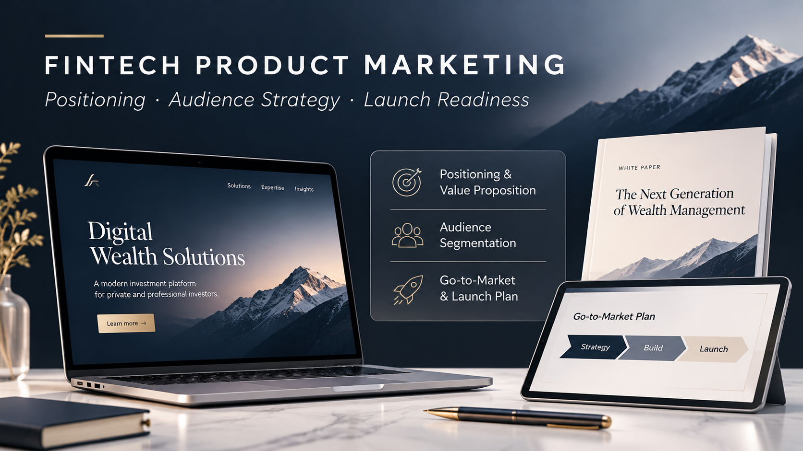

# fintech-gtm-case-study
An anonymized product marketing case study: audience prioritization, positioning, launch preparation, content delivery, and stakeholder coordination.

### Methodology & AI Disclosure

This case study is based on my own professional experience, strategic decisions, and work deliverables. I personally developed the underlying marketing strategy, analyses, positioning, and go-to-market approach.

AI tools were used solely to support the structuring, organization, and editorial refinement of this document. All substantive content, professional insights, and strategic decisions reflect my own work and experience.

# From Product Development to Marketing Launch Readiness

Estimated reading time: 12 min

### Building the marketing foundations for a new consumer fintech proposition

**An anonymized Product Marketing case study**  
Customer insight · Audience prioritization · Competitive positioning · Messaging · Digital experience · Launch preparation · Cross-functional delivery

**The story in 30 seconds**  
An established digital-investment business was developing a new consumer-facing proposition, but its marketing foundations were not yet in place. I authored the marketing and go-to-market strategy, secured leadership approval, and translated it into audience priorities, positioning, website copy, and a substantial content program. When commercialization was suspended pending regulatory authorization, I adapted the plan and organized the handover.  
 
The engagement delivered a completed website, **60 written blog articles, including 40 published**, and finalized launch materials. Commercial acquisition and conversion performance remained untested.

| Role | Situation | Scope | Outcome |
|---|---|---|---|
| **Marketing Lead & Strategy & GTM** | New consumer proposition / product under development | Positioning, segmentation, brand coordination, website copy, content, launch planning, agency evaluation | Strategy approved; website completed and briefly published / marketing assets prepared / commercial activation paused |

**Reading guide:** The executive summary and decision highlights take approximately two minutes. The sections below explain the supporting reasoning, delivery model, evidence, and limitations. All examples are anonymized; illustrative frameworks are not reproduced internal documents.

## Executive summary

### The business challenge

The business already served investors through an established advisory and distribution ecosystem. Its next ambition was a direct-to-consumer experience, supported by a mobile product offering access to digital-asset investment services and different approaches to portfolio management.

When I joined, a product specification existed and a designer and developer were working on the experience. Yet foundational go-to-market questions remained open: **Who should we prioritize? Why would customers choose this offer? How should we explain a complex financial proposition? What should be prepared before commercial activation?** The name, brand identity, segmented messaging, editorial structure, and launch plan needed to be built or finalized.

### My mandate

I was brought in to establish the consumer marketing foundation. I authored the strategy and proposed objectives, presented them to leadership, and secured internal approval. I then worked with commercial teams and external specialists to turn the plan into concrete deliverables: segmentation, positioning, brand coordination, website messaging, editorial assets, proposed customer journeys, and launch preparations.

### Three decisions that shaped the work

1. **Compete on relevance, not awareness.** Rather than attempt to outspend better-known consumer platforms for mass-market attention, I recommended a wealth-oriented narrative emphasizing long-term context, education, transparency, and appropriate human guidance.
2. **Prioritize by likely ease of activation, not investment size alone.** Within a broader audience model, I proposed initial emphasis on digitally fluent prospective investors and entrepreneurs, while designing separate educational approaches for more cautious audiences.
3. **Build a connected journey rather than isolated campaigns.** Segments informed editorial categories, page messaging, educational resources, planned email sequences, webinar concepts, and proposed qualification logic.

### What was delivered

The website was **developed, approved, and briefly published**. I wrote **60 blog articles, 40 of which were published** before the website was withdrawn. I also wrote all copy for **approximately ten presentation pages**. I wrote three white papers per audience profile. The white papers were finalized, designed, and approved. Brand and positioning decisions, email and newsletter content, webinar preparation, an acquisition partner selection, and a coordinated launch plan were completed or prepared to the stages described below.

## 1. The starting point: a developing product without a complete market narrative

The company was moving from an established adviser-supported model toward a consumer-facing experience. The application was still in development: a specification existed, early UX concepts were available, and functionality was being built. Defining the underlying investment offer and core application functionality was **not** my remit.

The gap was a market-facing one. The organization needed to connect a technically complex proposition to identifiable customers and a credible, coherent explanation of its value.

| Workstream | Situation when I joined | What needed to happen |
|---|---|---|
| Product | Specification and design/development in progress | Translate capabilities into understandable customer language |
| Audiences | Potential audiences discussed; priorities not established | Develop usable segments and choose where to concentrate effort |
| Brand | New name and identity not finalized | Coordinate naming and branding decisions |
| Positioning | Differentiated consumer narrative not fully articulated | Establish a strategic territory and message architecture |
| Website | Initial design ideas existed | Finalize content architecture, copy, and marketing experience |
| Editorial & demand generation | Consumer program not yet structured | Produce content and prepare acquisition, nurturing, and qualification |
| Launch | Authorization and timing outside marketing control | Separate preparation milestones from permission to commercialize |

**The core problem was not an underperforming live funnel. It was building a coherent market proposition before the funnel could exist.**

### Constraints

- A small marketing function, with temporary freelance support for design and marketing delivery, alongside external creative and technical specialists.
- A developing product and evolving design decisions.
- Multiple audience types with different levels of knowledge, motivations, and trust.
- Executive approval required for major strategic and budget decisions.
- A commercial launch dependent on regulatory authorization.

---

## 2. My role, ownership, and operating model

I operated as the **Marketing Lead**, with substantial autonomy on strategy development, content, messaging, and coordination. Leadership approved the main strategic decisions. I worked with executive stakeholders, business development, commercial colleagues, a freelance contributor, and an external designer/developer team.

To make attribution clear, the table distinguishes work I owned, work I helped shape, and work outside my remit.

| **Owned and authored** | **Co-developed or coordinated** | **Not my ownership** |
|---|---|---|
| Marketing and GTM plan; proposed objectives and KPIs | Naming and identity with creative providers | Investment product definition and technical roadmap |
| Audience segmentation and prioritization recommendations | Website information architecture with UX designer | Final UX/design authority |
| Positioning and messaging | Product presentation and CTA discussions | Application development |
| Marketing copy for website pages | Weekly website delivery and approvals | CRM setup and lead-scoring automation implementation |
| Editorial planning; blog and white-paper writing | Webinar preparation and supporting assets | Running and optimizing paid campaigns |
| Newsletter and email-sequence copy | Consultation and selection of acquisition providers | Regulatory authorization and launch decision |
| Acquisition recommendations and budget proposals | Stakeholder alignment and handover | Post-launch revenue or acquisition performance |

This was **cross-functional leadership of the marketing workstream**, not sole ownership of product, engineering, or the full customer experience.

---

## 3. Customer research: from hypotheses to actionable segmentation

### How I developed the segmentation

I started with desk research, category analysis, and hypotheses about prospective investors. I then used discussions with commercial and business-development colleagues to refine expected objectives, objections, knowledge levels, decision processes, and channels. The resulting profiles were reviewed and approved internally.

This was **research-informed, stakeholder-validated segmentation**. It was *not* a completed program of direct customer interviews or a model proven through live funnel data. Customer preferences and acquisition assumptions still required testing.

Each audience profile connected four questions:

1. **What is this customer trying to accomplish?**
2. **What holds them back?** Technical complexity, uncertainty, time, trust, or understanding of risks.
3. **What must the message explain?** Benefits, mechanics, responsibilities, trade-offs, and limitations.
4. **What interaction would be appropriate next?** Education, additional information, a proposed expression of interest, or eventual human discussion.

### The audience model

The working framework included **six consumer profiles** and **two professional-intermediary profiles** relevant to the existing distribution ecosystem. The intermediary profiles explored continuity between the established business and the new proposition; they did not represent a completed cross-selling program.

| Illustrative consumer group | Core question or tension | Messaging/content implication |
|---|---|---|
| Digitally fluent emerging investor | “Can this fit into a straightforward digital experience?” | Direct language, transparency, understandable product presentation |
| Entrepreneur | “How might this fit broader financial priorities without requiring day-to-day attention?” | Clarity on process, control, responsibilities, and risk |
| Time-constrained professional | “How can I understand what I am delegating?” | Plain-language explanations, oversight, educational guidance |
| Independent professional | “How does this relate to my wider financial situation?” | Contextual education and access to informed discussion |
| Property-focused investor | “How should I think about a new asset category?” | Introductory explanations and balanced risk discussion |
| Established wealth holder | “Can I understand and trust this experience?” | Higher-touch educational materials and clear description of the service |

*These are simplified, reconstructed audience archetypes, not copies of confidential persona sheets or claims about everyone within a demographic category.*

### Why I prioritized two segments

I recommended giving more initial attention to **digitally fluent younger investors** and **entrepreneurs**, while continuing to address other profiles with different content and resource intensity.

- **Digitally fluent investors:** the priority hypothesis was faster understanding and decision-making, thanks to familiarity with digital assets and mobile experiences, not a larger expected initial investment.
- **Entrepreneurs:** the hypothesis combined potential commercial relevance with an interest in broader financial diversification and a relatively accessible conversation about the proposition.
- **More cautious audiences:** they remained relevant, but were expected to require more education and reassurance before expressing interest.

I also revised an initial assumption: an older wealth-holder audience was not among my first choices, but commercial feedback justified adding it and tailoring the proposed channels and message depth.

Decision principle: address several audiences, but do not allocate scarce attention equally to all of them. These were prioritization hypotheses, not proven relative CAC or conversion findings.

### How personas changed actual marketing work

The audience matrix informed website explanations, blog categories, white paper topics, email copy, and proposed nurturing journeys. I wrote three white papers per audience profile, adapting the topics and framing to the needs identified in the segmentation.

---

## 4. Competitive analysis and the positioning decision

### The competitive problem

My review covered multiple market alternatives, including more visible consumer platforms. A key observation was the strength of mass-market brands in awareness and accessible category education. Trying to match that awareness immediately would have been an expensive, weakly differentiated starting point for a new proposition.

I recommended a different territory: **digital-asset investing understood within longer-term wealth considerations**, supported by understandable explanations, appropriate human guidance, and transparency about the experience.

This was an opportunity identified through my research and strategic judgment, **not** proof that competing businesses lacked comparable services or that the recommended proposition was unique.

| Strategic question | Alternative positioning emphasis considered | My recommended direction |
|---|---|---|
| Why consider the offer? | Access to digital assets and trading-oriented features | Relevance to considered, longer-term financial decisions |
| How to reduce friction? | Convenience and simple product access | Education, clarity on operation and responsibilities |
| What builds trust? | Familiarity and recognizable consumer brands | Clear explanations, human contact where appropriate, transparent limitations |
| How to speak to customers? | Broad platform-level marketing | Segment-specific messages addressing distinct questions |
| What to emphasize first? | Awareness and scale | Fit, relevance, and a credible, coherent brand narrative |

### The proposed positioning architecture

**Pillar 1: Longer-term wealth context.** Move away from speculative language toward how investors may consider this asset category alongside other financial decisions.

**Pillar 2: Education and clarity.** Explain concepts, processes, responsibilities, and risks without assuming prior expertise.

**Pillar 3: Human support.** Describe potential expert interaction alongside the digital interface, without promising a service capability that was not available.

**Pillar 4: Personal relevance.** Adapt language and educational depth to differences in familiarity, objectives, and concerns.

The recommendation was approved by leadership and translated into the new website's messaging. I also explored possible future themes around succession, ownership structures, and broader financial integration. Those themes were **ideas for longer-term differentiation**, not features I claim were built or launched.

### How the decision translated into copy

Instead of leading with a list of technical features, the marketing narrative aimed to answer questions in a meaningful sequence:

1. What is the offer, and whom is it designed for?
2. What choices and forms of management would the user have?
3. What does the investor control or delegate?
4. How does the digital experience work?
5. Where can the user obtain explanations or support?
6. Which risks, limitations, and authorization conditions must be clearly understood?

**Messaging discipline matters in financial services.** Investment risks cannot be erased by “professional management,” and regulatory approval must not be implied before it is obtained. Historical copy is therefore paraphrased here. This is not a claim that I personally certified legal compliance.

---

## 5. From positioning to website and content delivery

### Website: shared UX process, marketing-led narrative

I did not begin with a blank design. An external UX designer had drafted initial concepts. We refined the information architecture together, discussed the presentation of product options and calls to action, and aligned the pages with the positioning and customer questions.

I wrote **all copy for the consumer website's presentation pages**. The designer retained primary UX/design expertise; the developer handled implementation. My contribution was to ensure that the language, content hierarchy, and customer-facing story were consistent with the marketing strategy.

We worked through recurring sprint-style reviews and weekly approvals, bringing the appropriate questions to leadership. The approach was collaborative: success depended on clarifying requirements and getting aligned decisions made, not claiming authority over every discipline.

### Content was organized around intent

The editorial approach linked audience needs, content topics, and suitable next steps. For example, readers seeking introductory explanations would encounter a different depth of material from those already familiar with the asset class. The proposed next step was proportional to demonstrated interest, not an assumption that reading one article proved an individual's identity or investment suitability.

| Deliverable | My contribution | Actual status |
|---|---|---|
| Consumer website | Full presentation-page copy, shared structure discussions, marketing review | **Developed, approved, briefly published** |
| Presentation pages | All copy for approximately ten pages | **Completed as part of website** |
| Blog | 60 articles written | **40 published** before withdrawal |
| Educational white papers | Three written per audience profile; coordination through finalization | **Finalized, designed, approved** |
| Newsletters | Editorial concepts and copy | **Ready; not sent** |
| Segmented email sequences | Persona-informed messaging and copy | **Prepared; not activated** |
| Webinar program | Topics, communication plans, materials and organizational preparation | **Prepared; events not held** |

The site was technically completed, approved, and briefly live. It was then taken offline when commercialization was placed on hold.

---

## 6. Designing the proposed acquisition and qualification journey

The goal was to build a connected education-led route from discovery to qualified interest, rather than run unrelated content and media initiatives.

### Intended journey: designed, not fully activated

| Stage | Customer question | Prepared or proposed component | Intended progression |
|---|---|---|---|
| Discover | “Is this relevant to me?” | Blog, educational posts, acquisition concepts | Explore a relevant topic |
| Understand | “How does the service work?” | Website explanations, white papers | Request more information |
| Evaluate | “Does it address my concerns?” | Persona-informed emails, webinar materials | Express a more specific interest |
| Stay informed | “What happens before the offer is available?” | Proposed priority-list messages and forms | Explicit opt-in, subject to applicable rules |
| Qualify | “Would a conversation help?” | Proposed behavioral signals and follow-up criteria | Potential commercial discussion once permitted |

**Implementation boundary:** I designed the journeys and qualification principles and prepared copy; CRM configuration and automation deployment were owned elsewhere.

### Proposed qualification logic (not a validated scoring model)

The planning considered signals such as requesting resources, attending a webinar, interacting with communications, expressing early interest, or requesting contact. The idea was to distinguish casual interest from a stronger intent to speak with someone.

Any future scoring model would need tested weights and thresholds, explicit consent and privacy review, and commercial validation. Email opens alone are a weak intent signal, and a content topic is not proof of a customer's financial circumstances.

### Planning metrics versus measured outcomes

The strategy defined proposed goals and measurement tools for qualified interest, engagement, and funnel conversion. Actual commercial outcomes are addressed in the results section.

I distinguish:

- **Readiness KPIs:** approved strategy, completed materials, site readiness, selected partners.
- **Audience KPIs to measure on activation:** qualified traffic, content engagement, opt-ins, webinar attendance.
- **Funnel KPIs to validate later:** lead qualification, meetings, customer activation, cost per lead, and actual acquisition cost.

A *cost per lead* is not a *customer acquisition cost*, and proposed targets are not achieved results.

---

## 7. Go-to-market delivery, vendors, and leadership

### Making a broad strategy executable

I translated the plan into sequenced work, assigned responsibilities, maintained shared documentation, and held regular reviews. Early sprints covered workspace and content infrastructure, editorial production, preparation of educational resources, email and capture assets, and webinar planning.

The underlying planning framework was broad. The execution discipline was to distinguish **things marketing could complete now** from **actions that depended on authorization, technical readiness, and later operational resources**.

### Stakeholder and provider coordination

| Stakeholder | Working relationship |
|---|---|
| Executive leadership | Review of positioning, strategic plan, major decisions and budgets |
| Business development / commercial teams | Refining audience assumptions, questions, and objections |
| UX designer | Co-developing architecture, content hierarchy, and CTA discussions |
| Developer | Content integration, implementation dependencies, site readiness |
| Freelance contributor supporting design and marketing delivery | Early work prioritization and delivery coordination |
| Acquisition agencies | Comparing capabilities, scopes, proposals, and budget recommendations |

I consulted approximately six acquisition agencies, negotiated quotations, and selected a prospective partner. Further execution was suspended. I prepared budget recommendations for leadership approval rather than independently authorizing spend.

### What I mean by leadership in this case

The leadership evidence is not a claimed large team or a dramatic conflict. It is the practical work of making strategic choices understandable, securing executive approval, maintaining a coherent direction across functions, following delivery, and documenting decisions so work could continue.

---

## 8. The launch pause: adapting without overstating success

Late in the engagement, management decided to put commercialization on hold because the necessary regulatory conditions were not in place for the planned activation. That was a leadership and regulatory decision beyond my remit.

I adjusted the near-term marketing plan to a lighter approach and dedicated the final phase of the engagement to handover. I updated a central working table covering completed materials, current status, outstanding decisions, and next steps for the future marketing owner. The original table is no longer available to me and is not represented as an attached artifact.

| Workstream | Completed | Prepared, not activated | Changed after pause |
|---|---|---|---|
| Strategy and positioning | Leadership-approved plan; segment priorities; messages | Future validation and optimization | Lighter near-term plan |
| Website | Copy, review, development and approval; briefly published | Broader active launch journey | Site withdrawn |
| Content | Articles written; subset published; white papers approved | Newsletters and segmented sequences | Publication/activation constrained |
| Acquisition | Agency consultation and selection; channel proposals | Paid campaigns and conversion experiments | Further activity suspended |
| Customer engagement | Webinar concepts, materials and workflows prepared | Webinars, full nurturing and lead scoring | Activation deferred |
| Continuity | Delivery documentation | Future operational implementation | Structured handover |

The roadmap distinguished completed deliverables from the activities that would require subsequent activation.

---

## 9. Results and evidence: an explicit boundary

### Results I can support from the engagement

- A **marketing and go-to-market strategy**, developed by me and approved by executive leadership.
- Internally validated **customer segmentation and priority hypotheses**.
- A recommended **wealth-oriented positioning**, approved and reflected in website messaging.
- Coordinated naming and brand development with external providers.
- A **completed consumer website**, briefly published, with my copy across approximately ten presentation pages.
- **60 blog articles authored**, including **40 published**.
- **White papers written per audience profile**, finalized, designed, and approved.
- Prepared newsletter, email, webinar, and qualification-journey materials.
- Consultation of multiple acquisition providers and **selection of an agency**.
- A revised plan and structured project handover following the launch pause.

### Results I deliberately do not claim

- Leads or new customers acquired by the postponed launch.
- Conversion uplift, return on advertising spend, customer acquisition cost, or revenue contribution.
- Validated persona economics, relative campaign performance, or calibrated scoring accuracy.
- Implemented CRM workflows or full automated customer journeys.
- Ownership of investment product development, application engineering, or final UX decisions.
- Availability of features proposed only as future strategic opportunities.

**Bottom line:** I delivered the strategic marketing foundation and substantial execution-ready assets. Because commercialization was paused, the business performance of the full GTM program remained untested.

---

## 10. What the experience taught me

**Product progress is not market readiness.** Engineering can advance before customer priorities, category narrative, and adoption paths are sufficiently clear. Product Marketing closes that gap.

**Good personas force decisions.** The point is not to make eight attractive profile cards; it is to choose audiences, understand objections, allocate effort, and change messages and journeys accordingly.

**Differentiation includes a deliberate decision not to compete everywhere.** Choosing a more focused, credibility-led narrative helped organize the site, content, and launch planning without trying to imitate better-known brands.

**Approval, delivery, and market validation are distinct.** Leadership approval confirms internal alignment; a finished website confirms delivery; neither proves product-market fit or commercial traction.

**Regulated launches need decision gates and contingency plans.** In hindsight, I would formalize earlier the differences among authorization-ready, technically ready, marketing-ready, and commercially live. I would test fewer hypotheses first, once permitted, before expanding channels.

**A responsible handover is a deliverable.** When conditions change, capturing what exists, what is unresolved, and what the next owner can do preserves operational value.

---

## 11. Skills demonstrated and relevance beyond digital assets

| Capability | Evidence in this engagement |
|---|---|
| **Strategic product marketing** | Customer and positioning problem framed before acquisition |
| **Research synthesis** | Desk research and business feedback converted into working segments |
| **Prioritization** | Different levels of focus and resource allocation proposed by audience |
| **Competitive positioning** | Alternative strategic territory recommended and approved |
| **Messaging architecture** | Positioning translated into web pages, guides, and segmented content |
| **Digital experience collaboration** | Website structure, UX discussion, copy, and cross-functional reviews |
| **Go-to-market planning** | Sequenced content, acquisition, qualification and activation design |
| **Execution** | Website delivery, editorial production, approved educational materials |
| **Stakeholder leadership** | Executive alignment and coordination across commercial and technical teams |
| **Vendor management** | Agency assessment, negotiated proposals, partner selection |
| **Adaptability** | Plan revised and handover structured after launch suspension |
| **Measurement integrity** | Planned targets kept separate from verified delivery and impact |

While the underlying category was digital-asset investing, the methods apply more broadly to **fintech, wealthtech, legaltech, and complex B2B/B2C software**: translating technical propositions into clear customer value, aligning stakeholders, and preparing a measurable route to market.

---

### Confidentiality, attribution and evidence note

This document is an **anonymized narrative of a real professional engagement**. It does not identify the business, product, individuals, partners, exact chronology, confidential commercial arrangements, or specific regulatory status. Some numbers are deliberately approximate. Frameworks and messaging are paraphrased or reconstructed rather than reproduced from internal documents; quantitative delivery claims are based on the author's project knowledge, not independently audited here.

No client records, original private strategy tables, proprietary designs, or internal screenshots are published. Nothing in this case is a claim of authorization, investment safety, investment performance, endorsement by the business, or financial advice. Any future publication should be reviewed against contractual confidentiality obligations and third-party intellectual-property rights.
